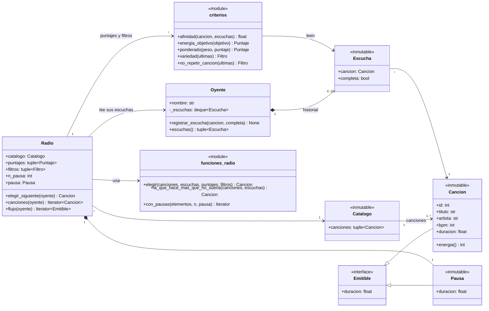

# UML final

Este es el diagrama que corresponde a la versión final de nuestro código. Para verlo como imagen, hay que ver el archivo desde markdown preview. 

**Cómo leerlo.**
- `funciones_radio` son las funciones sueltas de `radio.py` (no es una clase). `criterios` es el módulo `criterios.py`.
- `Puntaje` y `Filtro` son tipos de función definidos en `criterios.py`: `(Cancion, escuchas) -> float` y `(Cancion, escuchas) -> bool`.
- `energia` y `escuchas` son propiedades: se leen como atributos (`cancion.energia`), pero se calculan.
- "0..100" es la memoria del oyente: guarda como máximo sus últimas 100 escuchas (se puede cambiar con `memoria`).
- El diagrama usa solo tres flechas: asociación (flecha normal), composición (rombo relleno) y herencia (triángulo vacío) que son las vistas en clase.
- La flecha de herencia hacia `Emitible` significa "es un Emitible": `Cancion` y `Pausa` cumplen lo que pide (tener `duracion`). En el código no hay herencia real: `Emitible` es un `Protocol` y ninguna clase escribe `class Cancion(Emitible)` (decisión 13). Usamos esta flecha porque es la más cercana entre las vistas en clase.
- `Catalogo` → `Cancion` es una asociación y no una composición. Las canciones se crean afuera (en `catalogo_datos.py`) y el catálogo solo las agrupa.
- La radio no guarda al oyente, lo recibe en cada llamada (`flujo(oyente)`). Por eso es una asociación y no una composición, el oyente no es parte de la radio, y dos oyentes pueden usar la misma radio.

## Qué cambió respecto del UML inicial, y por qué

| Elemento | UML inicial | UML final | Por qué |
|---|---|---|---|
| `Catalogo` | `canciones` era una lista y tenía `agregar_cancion` | Tupla inmutable, sin `agregar_cancion`, y se valida al crearlo | Un catálogo que cambia mientras corre el flujo rompe la garantía de que los mismos datos dan el mismo flujo (decisión 8). |
| `Cancion` | `energia` era un dato | Guarda `bpm` y la `energia` se calcula | Para que bpm y energía no puedan contradecirse (decisión 9) y por si se desea cambiar la manera de calcular la energia. |
| `Oyente` | Guardaba `escuchas_completas` y tenía `registrar_escucha_completa(cancion)` | Guarda todas las escuchas, con un máximo, y tiene `registrar_escucha(cancion, completa)` | Una canción cortada también sonó y tiene que contar para la variedad (decisión 7). El tope evita que el historial crezca para siempre (decisión 10). |
| `Escucha` | No existía | Clase nueva: canción + si fue completa | Hace falta para guardar escuchas completas y cortadas (decisión 7). |
| `Pausa` y `Emitible` | No existían. La pausa era solo un comentario en `flujo` | `Pausa` es una clase y las dos cumplen la interfaz `Emitible` | El flujo mezcla canciones y pausas, y tiene que tener un tipo común (decisión 13). |
| Criterios | Recibían `(cancion, oyente)`. Había `afinidad`, `energia_objetivo` y `variedad` | Reciben `(cancion, escuchas)`, se agregaron `no_repetir_cancion` y `ponderado`, y se separaron puntajes y filtros | Para que sean puros (decisión 2). `no_repetir_cancion` corrige la burbuja de filtro (ETICA.md). `ponderado` es parte del cambio de requisito (decisión 11). Los filtros funcionan como veto (decisión 3). |
| `Radio` | Solo tenía `n_pausa` y `flujo(oyente)` | Tiene catálogo, puntajes, filtros y pausa, y se agregaron `elegir_siguiente` y `canciones` | La radio se arma componiendo sus piezas (decisión 13), y la elección quedó separada del flujo. |
| Funciones de `radio.py` | No existían | `elegir`, `la_que_hace_mas_que_no_suena`, `con_pausas` | `elegir` concentra la decisión en una función pura con desempate fijo (decisión 4). `con_pausas` separa la regla de pausas de la elección de canciones (cambio de requisito, decisión 1). |
| Relaciones | `Oyente` se asociaba directamente con `Cancion` y  los criterios dependían de `Oyente` | `Oyente` compone `Escucha`, que apunta a `Cancion`, los criterios dependen de `Escucha` | Sigue los cambios de arriba. El historial es de escuchas, y los criterios no conocen al oyente. |
